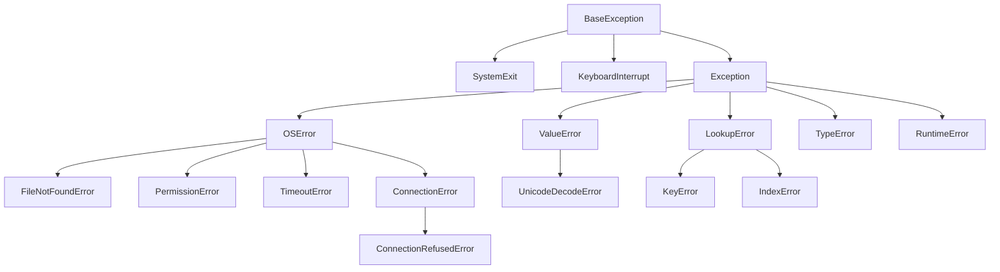

# 6 · Hata yönetimi, test ve günlük kaydı

<div class="kunye" markdown>
<span>Süre: ~60 dk + uygulama</span><span>Düzey: Orta</span><span>Ön koşul: Bölüm 4–5</span>
</div>

!!! hedef "Öğrenme hedefleri"
    Bu bölümün sonunda:

    - Python'un istisna hiyerarşisini ve `try/except/else/finally` bloklarının çalışma sırasını açıklayabilirsiniz.
    - Bir istisnanın çağrı yığınında nasıl yayıldığını ve traceback'in nasıl okunduğunu açıklayabilirsiniz.
    - `raise ... from` ile hata zinciri kurabilir, uygulamaya özgü istisna sınıfları tasarlayabilirsiniz.
    - `logging` modülünün günlükçü, işleyici ve biçimlendirici yapısını kullanarak yapılandırılmış günlük üretebilirsiniz.
    - pytest ile testler, fixture'lar ve parametreli testler yazıp çalıştırabilirsiniz.
    - `unittest.mock` ile donanım bağımlı kodu donanım olmadan sınayabilirsiniz.

## 6.1 İstisnalar ve hiyerarşi

C'de hatalar genellikle dönüş değeriyle bildirilir: `-1` döner ve ayrıntı `errno` değişkenine yazılır.
Dönüş değerinin denetlenmesi unutulduğunda hata sessizce yayılır. Python'da hatalar **istisna**
(exception) nesneleriyle bildirilir: bir hata oluştuğunda normal akış durur ve istisna, onu yakalayan
bir `except` bloğu bulunana kadar çağrı yığınında yukarı doğru ilerler. Yakalanmayan istisna programı
sonlandırır ve bir traceback yazdırır. Böylece hata hiçbir durumda sessizce kaybolmaz.

Tüm istisnalar bir sınıf hiyerarşisinin parçasıdır. `except X` bloğu `X` sınıfını ve **tüm alt
sınıflarını** yakalar:



Hiyerarşinin üç noktası pratikte önemlidir:

- **`SystemExit` ve `KeyboardInterrupt`, `Exception`'ın alt sınıfı değildir.** `sys.exit()` ve Ctrl+C bu
  istisnaları yükseltir. `except Exception:` bunları yakalamaz; çıplak `except:` ise yakalar ve
  programın kapanmasını engeller. Çıplak `except:` bu nedenle kullanılmamalıdır.
- **İşletim sistemi hataları `OSError` altında toplanır.** Her alt sınıf bir `errno` değerine karşılık gelir
  (PEP 3151): `ENOENT` → `FileNotFoundError`, `EACCES` → `PermissionError`, `ETIMEDOUT` → `TimeoutError`.
  `socket.timeout` 3.10'dan beri `TimeoutError`'ın takma adıdır. Seri port ve soket hataları bu
  hiyerarşiyle birlikte ele alınır.
- **Alt sınıf önce yakalanmalıdır.** `except` blokları yukarıdan aşağı sınanır ve ilk eşleşen çalışır.
  `TimeoutError` bir `OSError` olduğundan, `except OSError:` bloğu önce yazılırsa zaman aşımı hiçbir
  zaman ayrı ele alınamaz. Kitabın `sensor-istemci` aracında sıra bu nedenle şöyledir:

```python title="examples/sensor-araclari/src/sensor_araclari/istemci.py (kesit)"
try:
    with serial.serial_for_url(arg.url, baudrate=arg.hiz, timeout=arg.zaman_asimi) as port:
        yazmac = oku(port, arg.adres, 0, 4)
except TimeoutError as hata:         # OSError'ın alt sınıfıdır; bu nedenle önce yakalanır
    log.error("cihaz yanıt vermedi: %s", hata)
    return 5
except (serial.SerialException, OSError) as hata:
    log.error("port açılamadı veya iletişim hatası: %s", hata)
    return 3
except (protokol.CerceveHatasi, protokol.CihazHatasi) as hata:
    log.error("protokol hatası: %s", hata)
    return 4
```

## 6.2 `try`, `except`, `else`, `finally`

```python
try:
    f = open(yol, encoding="utf-8")       # yalnızca hata beklenen satırlar
except FileNotFoundError:
    log.warning("%s yok, varsayılanlar kullanılıyor", yol)
    ayar = {}
else:                                     # try bloğu hatasız bittiyse
    with f:
        ayar = json.load(f)
finally:                                  # her durumda: hata, return, break dahil
    log.debug("yapılandırma adımı bitti")
```

`try` bloğu mümkün olduğunca dar tutulur. Yalnızca hata beklenen satırlar `try` içine yazıldığında,
başka bir satırdaki beklenmeyen hata yanlışlıkla aynı `except` bloğuna düşmez. `else` bloğu bu ayrımı
sağlar: `json.load` sırasında oluşan bir hata, `FileNotFoundError` gibi işlem görmez.

Python topluluğunda yaygın yaklaşım **EAFP**'dir ("izin istemek yerine özür dilemek"): önce denetleyip
sonra işlem yapmak (`if yol.exists(): open(yol)`) yerine işlem yapılır ve hata yakalanır. Bu yaklaşım
yalnızca kısa değil, aynı zamanda daha doğrudur: denetim ile işlem arasında dosya silinebilir
(yarış durumu), `try` ise işlemin kendisini korur.

Yakalanan bir istisna `raise` ile (argümansız) yeniden yükseltilebilir; bu biçim özgün traceback'i
korur. Bir hatayı günlüğe yazıp yeniden yükseltmek, hatanın hem kaydedilmesini hem de üst katmanda
ele alınmasını sağlar.

## 6.3 Yayılma ve traceback

Bir istisna yükseltildiğinde yorumlayıcı o anda çalışan fonksiyonda uygun bir `except` arar. Bulamazsa
fonksiyonun çerçevesi kapatılır ve aynı arama çağıran fonksiyonda yinelenir. Bu süreç bir eşleşme
bulunana veya yığının tepesine ulaşılana kadar sürer. Aradaki fonksiyonların hata için hiçbir şey
yazmasına gerek yoktur; hata yönetimi, kararın verilebileceği tek bir katmanda toplanabilir.

<div class="akis" data-senaryo="istisna-yayilim"></div>

Yakalanmayan istisnanın traceback'i **aşağıdan yukarıya** okunur: son satır istisnanın türü ve
iletisidir; hemen üstündeki çerçeve hatanın doğduğu yerdir; en üstteki çerçeve en dıştaki çağrıdır.
Python 3.11'den itibaren her satırın altındaki `^^^^` işaretleri hatanın satırdaki tam konumunu
gösterir; uzun bir ifadede hangi alt ifadenin hata verdiği bu sayede görülür.

<div class="terminal" data-oturum="istisna-kayit"></div>

## 6.4 Hata zinciri: `raise ... from`

Düşük düzeyli bir hata çoğu zaman üst katman için anlamsızdır: `ValueError: invalid literal for int()`
iletisi, kullanıcıya hangi ayarın yanlış olduğunu söylemez. Hatanın yakalanıp anlamlı bir istisnaya
dönüştürülmesi gerekir; ancak özgün hata tanı için kaybedilmemelidir:

```python title="examples/bolum-06/istisna_zinciri.py (kesit)"
def ayar_yukle(anahtar):
    try:
        return deger_oku(anahtar)
    except (KeyError, ValueError) as hata:
        raise YapilandirmaHatasi(anahtar, hata) from hata
```

`from hata`, yeni istisnanın `__cause__` niteliğine özgün hatayı bağlar ve traceback'te "The above
exception was the direct cause of the following exception" satırıyla iki hata birlikte gösterilir.
Üç durum ayırt edilir:

| Yazım | `__cause__` | `__context__` | Traceback'teki bağlaç |
|---|---|---|---|
| `raise Yeni(...) from hata` | `hata` | `hata` | "direct cause" |
| `except` içinde yalnızca `raise Yeni(...)` | `None` | yakalanan hata (örtük) | "During handling of the above exception, another exception occurred" |
| `raise Yeni(...) from None` | `None` | yakalanan hata, ancak gösterilmez | Yalnızca yeni hata |

İkinci durum, `except` bloğunun içinde **beklenmeyen** bir hata oluştuğunu anlatır ve okuyanı yanıltabilir;
bilinçli dönüştürmelerde her zaman `from` yazılmalıdır. `from None`, özgün hata kullanıcı için gürültü
olduğunda (ör. `KeyError` yerine "bilinmeyen sensör adı" iletisi verilirken) kullanılır.

## 6.5 Uygulamaya özgü istisnalar

Bir uygulama veya kütüphane kendi hata türlerini tanımladığında, çağıran taraf bu türleri diğer
hatalardan ayırt edebilir. İyi bir tasarım tek bir ortak ata sınıfı ve onun altında anlamlı alt
sınıflar içerir:

```python title="examples/sensor-araclari/src/sensor_araclari/protokol.py (kesit)"
class CerceveHatasi(ValueError):
    """Çerçeve bozuk: uzunluk, CRC veya alanlar beklenenle uyuşmuyor."""


class CihazHatasi(Exception):
    """Cihaz, Modbus istisna yanıtı döndürdü."""

    KODLAR = {1: "geçersiz işlev", 2: "geçersiz yazmaç adresi", 3: "geçersiz değer"}

    def __init__(self, kod: int) -> None:
        self.kod = kod
        super().__init__(f"cihaz hata kodu {kod}: {self.KODLAR.get(kod, 'bilinmiyor')}")
```

Tasarımda dikkat edilen noktalar:

- **Doğru yerleşik atayı seçmek:** Bozuk çerçeve bir değer hatasıdır; `CerceveHatasi` bu nedenle
  `ValueError`'dan türer. Böylece `except ValueError` yazan genel kod da onu yakalar.
- **Makinenin okuyabileceği nitelikler:** `CihazHatasi.kod`, `OlcumHatasi.satir_no` gibi nitelikler,
  çağıranın iletiyi ayrıştırmadan karar vermesini sağlar (testlerde `bilgi.value.kod == 2` denetimi gibi).
- **`super().__init__(ileti)` çağrısı:** `str(hata)` ve traceback'teki ileti bu çağrıdan gelir.

Python 3.11 ile gelen `ExceptionGroup` ve `except*` söz dizimi, birden çok bağımsız hatanın (aynı anda
sorgulanan birkaç cihazdan gelen zaman aşımları gibi) birlikte taşınmasını ve türe göre ayrı ayrı
yakalanmasını sağlar. Bu yapı özellikle `asyncio.TaskGroup` ile kullanılır.

## 6.6 Günlük kaydı: `logging`

`print()` geliştirme sırasında yeterlidir, ancak bir servis olarak çalışan programda üç eksiği vardır:
iletilerin önemi (bilgi mi, hata mı) belirtilemez; ayrıntı düzeyi kodu değiştirmeden ayarlanamaz;
iletilerin nereye gideceği (terminal, syslog, dosya) seçilemez. `logging` modülü bu ayrımları dört
bileşenle yapar:

| Bileşen | Görevi | Örnek |
|---|---|---|
| **Logger** (günlükçü) | İletinin kaynağı; noktalı adlarla hiyerarşi oluşturur | `logging.getLogger("sensor_araclari.cli")` |
| **Handler** (işleyici) | İletinin hedefi | `StreamHandler` (stderr), `SysLogHandler`, `RotatingFileHandler` |
| **Formatter** (biçimlendirici) | Satırın biçimi | `"%(asctime)s %(levelname)s %(name)s: %(message)s"` |
| **Filter** | İleti bazında ek süzme | Belirli bir cihaz adresinin iletilerini ayıklama |

Düzeyler sayısaldır: `DEBUG` 10, `INFO` 20, `WARNING` 30, `ERROR` 40, `CRITICAL` 50. Bir ileti, hem
günlükçünün **etkin düzeyini** hem de işleyicinin düzeyini geçerse yazılır. Düzeyi ayarlanmamış bir
günlükçü, düzeyini hiyerarşideki ilk ayarlanmış atadan alır; ileti ise varsayılan olarak üst
günlükçülerin işleyicilerine de iletilir (propagation). Bu yapı, yalnızca `agecidi.seri.modbus`
günlükçüsü için DEBUG açılmasına izin verir; terminal oturumundaki `kayit_ornegi.py` bunu gösterir.

!!! iyi "Kütüphane günlükçü alır, uygulama yapılandırır"
    Kütüphane ve modül kodu yalnızca `log = logging.getLogger(__name__)` satırını içerir; düzey, işleyici
    veya biçim ayarlamaz. Yapılandırma programın giriş noktasında (`main()`) bir kez yapılır.
    Böylece aynı modül bir komut satırı aracında stderr'e, bir serviste syslog'a, testte pytest'in
    yakalama mekanizmasına yazabilir. `__name__` kullanımı günlükçü hiyerarşisini paket yapısıyla
    otomatik olarak eşler.

İleti biçimlendirmesinde f-string yerine `%` biçimi ve ayrı argümanlar kullanılır:
`log.debug("istek: adres=%d", adres)`. Bu yazımda metin, ileti gerçekten yazılacaksa oluşturulur;
DEBUG kapalıyken biçimlendirme maliyeti oluşmaz. Ayrıca aynı biçim dizgisine sahip iletiler, günlük
toplama sistemlerinde tek bir ileti türü olarak gruplanabilir. Bir `except` bloğunda `log.exception()`
iletiyle birlikte traceback'i de ERROR düzeyinde yazar.

Kitabın paketi yapılandırmayı `kayit.py` modülünde `logging.config.dictConfig` ile yapar:

```python title="examples/sensor-araclari/src/sensor_araclari/kayit.py (kesit)"
def yapilandir(ayrinti: int = 0, syslog: bool = False) -> None:
    duzey = {-1: "ERROR", 0: "WARNING", 1: "INFO"}.get(ayrinti, "DEBUG")
    duzey = os.environ.get("LOG_DUZEYI", duzey).upper()
    isleyiciler = {
        "stderr": {"class": "logging.StreamHandler", "formatter": "duz", "stream": "ext://sys.stderr"},
    }
    if syslog and os.path.exists("/dev/log"):
        isleyiciler["syslog"] = {"class": "logging.handlers.SysLogHandler",
                                 "address": "/dev/log", "formatter": "syslog"}
    logging.config.dictConfig({
        "version": 1,
        "disable_existing_loggers": False,
        "formatters": {"duz": {"format": BICIM, "datefmt": "%H:%M:%S"},
                       "syslog": {"format": SYSLOG_BICIMI}},
        "handlers": isleyiciler,
        "root": {"level": duzey, "handlers": list(isleyiciler)},
    })
```

`disable_existing_loggers: False` önemlidir: varsayılan `True` değeri, yapılandırmadan önce
oluşturulmuş günlükçüleri (modül düzeyinde `getLogger` çağrısı yapan tüm modüller) devre dışı bırakır.

Gömülü sistemlerde günlüklerin nereye yazılacağı da bir tasarım kararıdır. systemd altında çalışan bir
servisin stderr çıktısı zaten journald'a gider; ek bir dosya işleyicisi gerekmez. Flash bellekli
cihazlarda sürekli büyüyen bir günlük dosyası hem alanı doldurur hem de belleği aşındırır; dosyaya
yazmak gerekiyorsa `RotatingFileHandler` ile boyut sınırı verilmeli ve mümkünse geçici bellekte
(`/run`, `/var/volatile`) tutulmalıdır.

## 6.7 pytest ile test

Python kodundaki tür ve ad hataları ancak ilgili satır çalıştığında ortaya çıktığından, otomatik testler
derleyicinin C'de yaptığı denetimin önemli bir kısmını üstlenir. **pytest**, Python topluluğunda
yaygın olarak kullanılan test çatısıdır. Test, adı `test_` ile başlayan sıradan bir fonksiyondur ve
beklentiler düz `assert` ifadeleriyle yazılır:

```python title="examples/sensor-araclari/tests/test_protokol.py (kesit)"
def test_crc_bilinen_deger():
    # CRC-16/MODBUS için standart sınama değeri: "123456789" -> 0x4B37
    assert protokol.crc16_modbus(b"123456789") == 0x4B37


def test_bozuk_crc_yakalanir():
    cerceve = bytearray(protokol.yanit_olustur(1, [214]))
    cerceve[3] ^= 0x01                                  # tek bir bit bozulur
    with pytest.raises(CerceveHatasi, match="CRC"):
        protokol.yanit_coz(bytes(cerceve), 1)
```

pytest, test modüllerini içe aktarmadan önce `assert` ifadelerini yeniden yazar; başarısızlıkta iki
tarafın değerleri ve ara ifadeler raporlanır. `pytest.raises` bloğu, beklenen istisnanın yükseltildiğini
doğrular; `match` parametresi iletiyi düzenli ifadeyle denetler.

<div class="akis" data-senaryo="pytest-akis"></div>

### Fixture'lar

**Fixture**, testin ihtiyaç duyduğu hazırlığı (geçici dosya, örnek veri, bağlantı, benzetici) sağlayan
fonksiyondur. Test, fixture'ı parametre adıyla ister; pytest bağımlılıkları çözer, değeri üretir ve
test bittikten sonra temizlik yapar. `tests/conftest.py` dosyasındaki fixture'lar o dizindeki tüm
testlerde içe aktarma yapılmadan kullanılabilir:

```python title="examples/sensor-araclari/tests/conftest.py (kesit)"
@pytest.fixture
def gecici_csv(tmp_path):                       # tmp_path: pytest'in yerleşik fixture'ı
    """İçeriği teste göre yazılan geçici bir CSV dosyası üreten fabrika fixture'ı."""
    def yaz(*satirlar: str) -> Path:
        yol = tmp_path / "olcum.csv"
        yol.write_text("zaman,sensor,deger,birim\n" + "".join(s + "\n" for s in satirlar),
                       encoding="utf-8")
        return yol
    return yaz


@pytest.fixture
def cihaz() -> SensorBenzetici:
    """Her test için yeni bir benzetici: testler birbirinin durumunu etkilemez."""
    return SensorBenzetici(adres=1)
```

Sık kullanılan yerleşik fixture'lar: `tmp_path` (teste özgü geçici dizin), `capsys` (stdout/stderr
yakalama), `monkeypatch` (ortam değişkeni, nitelik veya `sys.path` değişikliğini test sonunda geri alma),
`caplog` (günlük kayıtlarını yakalama). Fixture'ın kapsamı (`scope="function"` varsayılan, `"module"`,
`"session"`) ne kadar paylaşılacağını belirler. Temizlik gerektiren fixture'lar `return` yerine `yield`
kullanır; `yield` sonrasındaki kod test başarısız olsa da çalışır.

!!! dikkat "caplog ve dictConfig"
    `caplog`, kök günlükçüye bir işleyici ekleyerek çalışır. Test edilen kod `logging.config.dictConfig`
    ile kök günlükçünün işleyicilerini yeniden tanımlarsa bu işleyici kaldırılır ve `caplog.text` boş
    kalır. Kitabın `cli.main()` fonksiyonu yapılandırma yaptığından, ilgili test günlük satırını
    `capsys` ile stderr üzerinden denetler (`tests/test_cli.py`).

### Parametreli testler

Aynı denetimin farklı girdilerle yinelenmesi için `@pytest.mark.parametrize` kullanılır. Her parametre
kümesi ayrı bir test öğesi olur ve ayrı raporlanır:

```python title="examples/sensor-araclari/tests/test_olcum.py (kesit)"
@pytest.mark.parametrize(
    "alanlar, beklenen",
    [
        (["t", "sensor0", "yirmi", "C"], "sayı değil"),
        (["t", "sensor0", "21.4"], "4 alan bekleniyordu"),
        (["t", "sensor0", "21.4", "F"], "bilinmeyen birim"),
    ],
    ids=["sayi-degil", "eksik-alan", "gecersiz-birim"],
)
def test_satir_ayristir_hatali(alanlar, beklenen):
    with pytest.raises(OlcumHatasi, match=beklenen):
        satir_ayristir(alanlar, satir_no=7)
```

`ids` verilmezse pytest kimlikleri değerlerden üretir; okunabilir kimlikler, başarısız bir durumun
raporda hemen tanınmasını sağlar. Belirli koşullarda çalışmaması gereken testler
`@pytest.mark.skipif(not Path("/dev/ttyUSB0").exists(), reason="donanım yok")` ile atlanabilir; bilinen
bir hatayı belgeleyen test `@pytest.mark.xfail` ile işaretlenir.

<div class="terminal" data-oturum="pytest-oturum"></div>

Günlük çalışmada sık kullanılan seçenekler: `-q` (kısa), `-v` (her test ayrı satırda), `-x` (ilk
hatada dur), `-k ifade` (adla seçim), `--lf` (yalnızca son çalıştırmada başarısız olanlar), `-ra`
(atlanan ve başarısız testlerin özeti; kitabın `pyproject.toml` dosyasında varsayılan olarak
etkindir). Çıkış kodu 0 tüm testlerin geçtiğini, 1 başarısızlığı, 5 hiç test toplanmadığını gösterir.

## 6.8 Sahte nesneler: `unittest.mock`

Seri port, ağ veya GPIO gibi donanım bağımlı kodun her testte gerçek donanımla çalıştırılması hem
yavaş hem de çoğu CI ortamında olanaksızdır. **Sahte nesne** (mock), gerçek nesnenin yerine geçen,
davranışı test tarafından programlanan ve kendisine yapılan çağrıları kaydeden bir nesnedir:

```python title="examples/sensor-araclari/tests/test_cli.py (kesit)"
def test_istemci_mock_port_ile():
    yanit = protokol.yanit_olustur(1, [0xFF83, 455, 1013, 1])
    port = mock.create_autospec(serial.Serial, instance=True)    # (1)!
    port.read.side_effect = [yanit[:5], yanit[5:]]               # (2)!

    assert istemci.oku(port, 1, 0, 4) == [0xFF83, 455, 1013, 1]
    port.write.assert_called_once_with(protokol.istek_olustur(1, 0, 4))   # (3)!
    assert port.read.call_args_list == [mock.call(5), mock.call(8)]


def test_istemci_zaman_asimi():
    port = mock.create_autospec(serial.Serial, instance=True)
    port.read.return_value = b""                                 # (4)!
    with pytest.raises(TimeoutError):
        istemci.oku(port, 1, 0, 4)
```

1.  **autospec:** Sahte nesne `serial.Serial` sınıfının arayüzünü taklit eder; gerçek sınıfta olmayan bir
    yöntem çağrılırsa veya yöntem yanlış sayıda argümanla çağrılırsa test hata verir. Düz `MagicMock`
    her çağrıyı kabul ettiği için yazım hatalarını gizler.
2.  **side_effect:** Ardışık çağrılarda sırayla dönecek değerler. Bir istisna sınıfı veya nesnesi verilirse
    çağrı o istisnayı yükseltir; donanım hatalarının benzetimi böyle yapılır.
3.  **Çağrı denetimi:** Kodun cihaza doğru baytları gönderdiği ve yanıtı iki aşamada okuduğu doğrulanır.
4.  **return_value:** Her çağrıda aynı değer döner; boş `bytes`, zaman aşımına uğramış bir `read()` çağrısının
    gerçek davranışıdır.

Sahte nesneler, test edilen kodun parametre olarak aldığı nesnelerle en kolay kullanılır; `istemci.oku()`
portu parametre olarak aldığı için yerine sahtesi doğrudan verilebilmiştir. Modülün içinde oluşturulan
nesneler için `mock.patch("sensor_araclari.istemci.serial.serial_for_url")` veya pytest'in `monkeypatch`
fixture'ı kullanılır. Sahte nesne kullanımı ölçülü tutulmalıdır: her şeyi sahteleyen bir test, gerçek
nesneyle uyumsuzluğu yakalayamaz. Bu kitapta protokol katmanı gerçek baytlarla, iletişim katmanı ise
sahte port, `loop://` ve sanal seri port ile üç ayrı düzeyde sınanır ([Bölüm 7](07-donanim-iletisim.md)).

## 6.9 Yocto bağlantısı

- **Hedefte test (ptest):** OE-Core'un `ptest-python-pytest` sınıfı, tarifin `tests/` dizinini
  `${PN}-ptest` paketine kurar ve `pytest --automake` çalıştıran bir `run-ptest` betiği üretir. İmaja
  `ptest` dağıtım özelliği ve paket eklendiğinde aynı testler hedef cihazdaki Python sürümüyle
  `ptest-runner` aracılığıyla çalıştırılabilir. Bölüm 1'de belirtilen "hedefte ayrıca sına" ilkesinin
  Yocto'daki karşılığı budur.
- **BitBake'te günlük ve hata:** Python görevlerinde `bb.note`, `bb.warn`, `bb.error` ve `bb.fatal`
  fonksiyonları `logging` düzeylerinin karşılığıdır; `bb.fatal` görevi sonlandıran bir istisna
  yükseltir. Görev günlükleri `temp/log.do_<görev>` dosyalarına yazılır
  ([Bölüm 8](08-bitbake-python.md), <a href="../../yocto-gomulu-linux/bolumler/14-hata-ayiklama.html">Yocto kitabı, Bölüm 14</a>).
- **CI:** Paketin testleri, Yocto derlemesinden önce sanal ortamda koşturulan hızlı bir CI adımı olarak
  çalıştırılır; pytest'in çıkış kodu adımın başarısını belirler
  (<a href="../../yocto-gomulu-linux/bolumler/18-ci.html">Yocto kitabı, Bölüm 18</a>).

!!! lab "Uygulama 6.1 · Test yazma ve hata ayıklama döngüsü"
    Sanal ortam etkinken `~/ornekler/sensor-araclari` dizininde:

    1. `tests/test_protokol.py` dosyasına Modbus istisna yanıtı için bilinen bir çerçeve testi ekleyin:
       `protokol.hata_yaniti_olustur(1, 3, 2)` sonucu `bytes.fromhex("01 83 02 C0 F1")` olmalıdır.
    2. `pytest -v -k hata_yaniti` ile yalnızca bu testi çalıştırın.
    3. `src/sensor_araclari/protokol.py` içinde `HATA_BITI = 0x80` satırını geçici olarak `0x40` yapın,
       `pytest -q` çalıştırın ve hangi testlerin neden başarısız olduğunu raporlardan okuyun.
    4. Değişikliği geri alın ve `pytest --lf` ile yalnızca son başarısız testlerin yeniden çalıştığını
       doğrulayın.
    5. `python ../bolum-06/istisna_zinciri.py --yakalama` çıktısındaki iki traceback'i aşağıdan yukarıya
       okuyarak hatanın doğduğu satırı ve dönüştürüldüğü satırı belirleyin.

## Özet

- İstisnalar bir sınıf hiyerarşisidir; `except X` alt sınıfları da yakalar, bu nedenle alt sınıf önce yazılır.
- `SystemExit` ve `KeyboardInterrupt` `Exception` altında değildir; çıplak `except:` kullanılmaz.
- `try` bloğu dar tutulur; `else` hatasız yol, `finally` her durumda çalışan temizlik içindir.
- İstisna, yakalanana kadar çağrı yığınında yukarı yayılır; traceback aşağıdan yukarıya okunur.
- `raise Yeni(...) from hata` özgün hatayı `__cause__` olarak korur; `from None` zinciri gizler.
- Uygulamaya özgü istisnalar ortak bir atadan türer ve makinenin okuyabileceği nitelikler taşır.
- Modüller yalnızca `getLogger(__name__)` kullanır; `logging` giriş noktasında bir kez yapılandırılır.
- pytest düz `assert` kullanır; fixture'lar hazırlık ve temizliği, `parametrize` girdi çeşitlemesini sağlar.
- `mock.create_autospec` gerçek arayüze bağlı sahte nesne üretir; donanım hataları `side_effect` ile benzetilir.

## Değerlendirme soruları

<div class="quiz" data-id="b06-1">
<p class="quiz-soru">Aşağıdaki sırayla yazılmış bloklarda bir <code>TimeoutError</code> oluştuğunda hangisi çalışır?<br>
<code>except OSError: ...</code> · <code>except TimeoutError: ...</code></p>
<ul>
<li><code>except TimeoutError</code>, çünkü daha özeldir</li>
<li data-dogru><code>except OSError</code>, çünkü bloklar sırayla sınanır ve <code>TimeoutError</code> bir <code>OSError</code>'dır</li>
<li>İkisi de çalışır</li>
<li>Hiçbiri; Python bu sırayı reddeder</li>
</ul>
<p class="quiz-aciklama">İlk eşleşen blok çalışır ve eşleşme <code>isinstance</code> mantığıyla yapılır. Özel tür ayrı ele alınacaksa önce yazılmalıdır.</p>
</div>

<div class="quiz" data-id="b06-2">
<p class="quiz-soru">Bir servis döngüsünde <code>try: ... except: pass</code> yazılmıştır. Bunun en ciddi sonucu nedir?</p>
<ul>
<li>Program yavaşlar</li>
<li data-dogru>Tüm hatalar sessizce yutulur; ayrıca <code>KeyboardInterrupt</code> ve <code>SystemExit</code> de yakalandığı için servis düzgün kapatılamayabilir</li>
<li>Yalnızca sözdizimi hataları yakalanır</li>
<li>Bir etkisi yoktur; Python çıplak <code>except</code> bloğunu yok sayar</li>
</ul>
<p class="quiz-aciklama">Çıplak <code>except</code> <code>BaseException</code>'ı yakalar. Beklenen hatalar adıyla yakalanmalı, en azından
<code>except Exception:</code> kullanılıp hata günlüğe (<code>log.exception</code>) yazılmalıdır.</p>
</div>

<div class="quiz" data-id="b06-3">
<p class="quiz-soru"><code>except ValueError as hata: raise YapilandirmaHatasi("aralik") from hata</code> satırından sonra yeni istisnanın <code>__cause__</code> değeri nedir?</p>
<ul>
<li><code>None</code></li>
<li data-dogru>Yakalanan <code>ValueError</code> nesnesi</li>
<li><code>YapilandirmaHatasi</code> sınıfı</li>
<li>Traceback metni</li>
</ul>
<p class="quiz-aciklama"><code>from</code> açık zinciri kurar ve traceback'te "direct cause" olarak gösterilir. <code>from</code> yazılmasaydı özgün hata
yalnızca örtük <code>__context__</code> olarak taşınırdı.</p>
</div>

<div class="quiz" data-id="b06-4">
<p class="quiz-soru">Bir kütüphane modülünde günlük kaydı için doğru yaklaşım hangisidir?</p>
<ul>
<li>Modülün başında <code>logging.basicConfig(level=logging.DEBUG)</code> çağırmak</li>
<li data-dogru>Yalnızca <code>log = logging.getLogger(__name__)</code> tanımlayıp yapılandırmayı uygulamaya bırakmak</li>
<li>Tüm iletileri <code>print(..., file=sys.stderr)</code> ile yazmak</li>
<li>Her fonksiyonda yeni bir <code>FileHandler</code> eklemek</li>
</ul>
<p class="quiz-aciklama">Yapılandırma bir kez ve giriş noktasında yapılır. Kütüphanenin kendi yapılandırması, onu kullanan uygulamanın
ayarlarını bozar.</p>
</div>

<div class="quiz" data-id="b06-5">
<p class="quiz-soru">pytest fixture'ında <code>yield</code> kullanılmasının amacı nedir?</p>
<ul>
<li>Fixture'ı üreteç olarak birden çok değer üretecek hale getirmek</li>
<li data-dogru>Değeri teste verdikten sonra, test bittiğinde (başarısız olsa da) çalışacak temizlik kodunu yazabilmek</li>
<li>Fixture'ı tüm oturum boyunca paylaşmak</li>
<li>Testin paralel çalışmasını sağlamak</li>
</ul>
<p class="quiz-aciklama"><code>yield</code> öncesi hazırlık, sonrası temizliktir. Paylaşım kapsamı ayrıca <code>scope</code> parametresiyle belirlenir.</p>
</div>

<div class="quiz" data-id="b06-6">
<p class="quiz-soru">Seri port nesnesinin yerine <code>mock.MagicMock()</code> yerine <code>mock.create_autospec(serial.Serial, instance=True)</code> kullanılmasının yararı nedir?</p>
<ul>
<li>Gerçek bir portu otomatik açar</li>
<li>Testleri hızlandırır</li>
<li data-dogru>Gerçek sınıfta olmayan yöntem çağrılarını ve yanlış argüman sayısını hata olarak yakalar</li>
<li>Çağrıların kaydedilmesini sağlar; MagicMock çağrıları kaydetmez</li>
</ul>
<p class="quiz-aciklama">İki tür de çağrıları kaydeder. autospec ek olarak arayüzü gerçek sınıfa bağlar; böylece <code>port.rede()</code> gibi bir yazım
hatası testte sessizce geçmez.</p>
</div>

!!! alistirma "Alıştırma: Yanıt doğrulama hatalarının parametreli testi"
    `protokol.yanit_coz()` fonksiyonu dört farklı durumda `CerceveHatasi` yükseltir: çerçeve çok kısa,
    yanıt başka adresten, işlev kodu beklenmeyen, bayt sayısı alanı veriyle uyumsuz. CRC denetimi
    diğer denetimlerden önce yapıldığı için, CRC'si doğru ama içeriği bozuk çerçeveler üretilmelidir.

    1. Bir gövdeye doğru CRC ekleyen yardımcı fonksiyon yazın.
    2. Dört durumu tek bir parametreli testte, okunabilir kimliklerle sınayın; her durumda iletinin ilgili
       parçasını `match` ile denetleyin.
    3. `loop://` portunu açıp test sonunda kapatan, `yield` kullanan bir fixture yazın ve basit bir
       yazma/okuma testiyle kullanın.

    ??? success "Örnek çözüm"
        ```python title="tests/test_yanit_hatalari.py"
        import pytest
        from sensor_araclari import protokol
        from sensor_araclari.protokol import CerceveHatasi


        def crc_ile(govde: bytes) -> bytes:
            """Gövdeye doğru CRC ekler: testler yalnızca istenen alanı bozabilsin."""
            return govde + protokol.crc16_modbus(govde).to_bytes(2, "little")


        @pytest.mark.parametrize(
            "cerceve, ileti",
            [
                (crc_ile(bytes([2, 3, 2, 0, 214])), "başka adresten"),
                (crc_ile(bytes([1, 4, 2, 0, 214])), "beklenmeyen işlev"),
                (crc_ile(bytes([1, 3, 4, 0, 214])), "bayt sayısı"),
                (b"\x01\x03", "çok kısa"),
            ],
            ids=["adres", "islev", "bayt-sayisi", "kisa"],
        )
        def test_yanit_coz_hatalari(cerceve, ileti):
            with pytest.raises(CerceveHatasi, match=ileti):
                protokol.yanit_coz(cerceve, beklenen_adres=1)


        @pytest.fixture
        def loop_port():
            import serial
            port = serial.serial_for_url("loop://", timeout=0.2)
            yield port                     # test burada çalışır
            port.close()                   # temizlik: test başarısız olsa da çalışır


        def test_loop_port_geri_doner(loop_port):
            loop_port.write(b"\x01\x03")
            assert loop_port.read(2) == b"\x01\x03"
        ```
        `pytest -v tests/test_yanit_hatalari.py` beş testin geçtiğini gösterir (dört parametreli durum ve
        fixture testi). CRC'nin `to_bytes(2, "little")` ile eklenmesi protokoldeki düşük bayt önce kuralıyla
        aynıdır. `crc_ile` yardımcısı olmadan yazılan bozuk çerçevelerin hepsi CRC denetiminde takılır ve
        test, sınanmak istenen denetimi hiç çalıştırmadan geçebilirdi; `match` parametresi bu yanlış
        pozitifi önler.

**Sonraki bölüm:** [7 · Donanımla iletişim: ikili veri, seri port, soketler →](07-donanim-iletisim.md)
