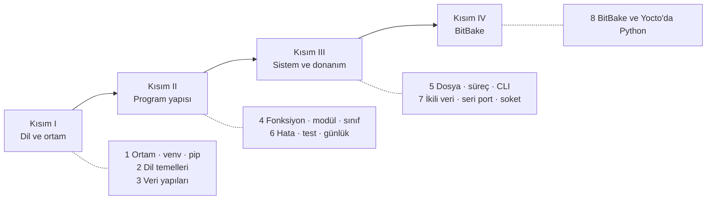

# Gömülü Geliştirici için Python

**Python dilini otomasyon, test, donanım iletişimi ve BitBake metadata'sı bağlamında anlatan açık kaynak, Türkçe öğretim kitabı.**

Gömülü Linux projelerinde hedef cihazdaki kodun önemli bir kısmı C ile yazılsa da bu kodu üreten,
sınayan ve cihaza ulaştıran araçların büyük bölümü Python'dur: Yocto Project'in derleme motoru
BitBake, tariflerdeki Python görevleri, seri port ve ağ üzerinden cihazla konuşan tanılama araçları,
üretim hattı test düzenekleri ve CI betikleri. Bu kitap Python'u genel bir programlama dili olarak
değil, bu işlerin aracı olarak ele alır. Her bölüm önce kavramı ve iç işleyişini açıklar, ardından
gerçekten çalıştırılmış örnekler, uygulama çalışmaları ve değerlendirme sorularıyla pekiştirir.

## Hedef kitle

- Yocto Project ile çalışan ve tariflerdeki Python kodunu okuyup yazması gereken gömülü yazılım mühendisleri
- C ağırlıklı geçmişe sahip olup test, otomasyon ve cihaz iletişimi araçları yazmaya başlayan geliştiriciler
- Seri port, Modbus veya TCP/UDP üzerinden cihazlarla konuşan araç ve test düzeneği geliştiren ekipler
- Gömülü sistemler dersi veren veya alan öğretim üyeleri ve öğrenciler

## Ön koşullar

- Linux komut satırının temel kullanımı: dizinler, dosyalar, borular, ortam değişkenleri
  (<a href="../bash-komut-satiri/index.html">Linux Komut Satırı ve Bash</a> kitabı yeterlidir)
- Herhangi bir programlama dilinde (tercihen C) temel deneyim: değişken, fonksiyon, döngü
- Örneklerin çalıştırılması için Python 3.10 veya sonrasını içeren bir Linux makinesi; kitaptaki
  çıktılar Ubuntu 24.04 üzerinde Python 3.12 ve 3.13 ile alınmıştır
- Bölüm 8 için BitBake kaynak ağacı (`git clone`), tam bir Yocto derleme ortamı gerekmez

## Kitabın yapısı

| Bölüm | Kapsam |
|---|---|
| [1 · Python ortamı](bolumler/01-python-ortami.md) | CPython'un çalışması, sürümler, `sys.path`, PEP 668, sanal ortamın iç yapısı, pip, `requirements.txt` ve `pyproject.toml` |
| [2 · Dil temelleri](bolumler/02-dil-temelleri.md) | Dinamik ve güçlü tipleme, ad bağlama ve kimlik, değiştirilebilirlik, sayılar, `str`/`bytes`, f-string, akış denetimi, `match` |
| [3 · Veri yapıları](bolumler/03-veri-yapilari.md) | `list`, `tuple`, `dict`, `set`, kavramalar, yineleme protokolü, dilimleme, sığ/derin kopya, `collections`, karmaşıklık |
| [4 · Fonksiyonlar, modüller, paketler ve sınıflar](bolumler/04-fonksiyon-modul.md) | Argüman türleri, LEGB, kapanışlar, dekoratörler, import sistemi, paket yapısı, sınıflar, `dataclass`, tip ipuçları |
| [5 · Dosyalar, süreçler ve komut satırı araçları](bolumler/05-sistem-programlama.md) | `pathlib`, kodlama, atomik yazma, bağlam yöneticileri, güvenli `subprocess`, `argparse`, JSON/CSV/INI, ortam değişkenleri, çıkış kodları |
| [6 · Hata yönetimi, test ve günlük kaydı](bolumler/06-hata-test-kayit.md) | İstisna hiyerarşisi, yayılma, `raise from`, özel istisnalar, `logging`, pytest, fixture, parametrize, `unittest.mock` |
| [7 · Donanımla iletişim](bolumler/07-donanim-iletisim.md) | `bytes`/`bytearray`, `struct` ve bayt sırası, CRC-16/MODBUS, Modbus RTU benzeri protokol, pyserial, sanal seri port, TCP/UDP, `select` |
| [8 · BitBake ve Yocto'da Python](bolumler/08-bitbake-python.md) | Veri deposu ve `d`, `${@...}`, Python görevleri, anonim Python, `bb.utils`/`oe.utils`, `bb.fatal`, `addpylib`, Python tarifleri |

Bölümler sırayla okunmak üzere yazılmıştır. Python bilen ve yalnızca Yocto'daki kullanımıyla
ilgilenen okur Bölüm 1'in 1.8 alt bölümünden sonra doğrudan Bölüm 8'e geçebilir; Bölüm 8'in
ihtiyaç duyduğu dil ayrıntıları için ilgili bölümlere bağlantı verilmiştir.

## Örnek proje

Kitap boyunca kitaplığın ortak senaryosu kullanılır: ekransız bir **endüstriyel sensör ağ geçidi**
(`agecidi`). Python tarafında bu senaryo için `sensor-araclari` adlı bir paket geliştirilir:

- `sensor-rapor`: ölçüm dosyalarını özetleyen, eşik denetimi yapan komut satırı aracı (Bölüm 5)
- `sensor-istemci`: sensör cihazını seri port veya TCP üzerinden Modbus RTU benzeri bir protokolle sorgulayan araç (Bölüm 7)
- protokol, ölçüm ve günlük modülleri ile bunların pytest testleri (Bölüm 4, 6, 7)
- donanım olmadan deneme yapmak için sanal seri port üzerinde çalışan bir cihaz benzeticisi

Bölüm 8'de ise OE-Core gerektirmeyen küçük bir BitBake projesi (`bbmini`) üzerinde tariflerdeki
Python kodu çalıştırılarak incelenir. Tüm kodlar deponun `examples/` dizinindedir ve
`examples/hepsini-dene.sh` betiğiyle tek komutla sınanabilir. Terminal canlandırmalarındaki tüm
çıktılar bu örnekler gerçekten çalıştırılarak alınmıştır.

## Kitaplıktaki yeri

Bu kitap **Gömülü Linux Kitaplığı**'nın bir parçasıdır ve kitaplığın merkezindeki
<a href="../yocto-gomulu-linux/index.html">Yocto Project ile Gömülü Linux</a> kitabını tamamlar.
Yocto kitabının 5. bölümünde (BitBake dili) ve 6. bölümünde (tarifler) kısaca değinilen Python
öğelerinin dil düzeyindeki karşılıkları bu kitapta ayrıntılı ele alınır. İlgili diğer kitaplar:

- <a href="../bash-komut-satiri/index.html">Linux Komut Satırı ve Bash</a>: kabuk, borular, çıkış kodları, ortam değişkenleri
- <a href="../git-surum-kontrolu/index.html">Git ile Sürüm Kontrolü</a>: örneklerin ve katmanların sürüm yönetimi
- <a href="../c-derleme/index.html">C, Make ve CMake ile Derleme</a>: hedef cihazdaki C kodu ve çapraz derleme
- <a href="../cekirdek-onyukleme/index.html">Linux Çekirdeği ve Önyükleme</a>: `/sys`, `/proc` ve seri konsol
- <a href="../aygit-surucusu/index.html">Linux Aygıt Sürücüsü Geliştirme</a>: kullanıcı alanından erişilen aygıtların çekirdek tarafı

## Okuma önerileri

- **Python'a yeni başlayanlar:** [Kitabın kullanımı](nasil-okunur.md) → [Bölüm 1](bolumler/01-python-ortami.md)'den itibaren sırayla
- **Yocto tariflerindeki Python kodunu anlamak isteyenler:** [Bölüm 1.8](bolumler/01-python-ortami.md#18-yoctoda-python-ortam), [Bölüm 2](bolumler/02-dil-temelleri.md) ve [Bölüm 8](bolumler/08-bitbake-python.md)
- **Cihaz iletişimi ve test aracı yazacaklar:** [Bölüm 5](bolumler/05-sistem-programlama.md), [Bölüm 6](bolumler/06-hata-test-kayit.md) ve [Bölüm 7](bolumler/07-donanim-iletisim.md)
- **Hızlı başvuru:** [Komut özeti](ekler/komut-ozeti.md), [Terimler sözlüğü](ekler/sozluk.md) ve [Animasyonlu şemalar](araclar/animasyonlar.md)

## Lisans ve katkı

Bu kitap açık kaynaklı bir topluluk çalışmasıdır. Metin
[CC BY-SA 4.0](https://creativecommons.org/licenses/by-sa/4.0/deed.tr), örnek kodlar MIT lisansıyla
yayımlanır. Düzeltme ve katkı önerileri her sayfanın üstündeki :material-file-edit-outline: düğmesiyle
veya [GitHub deposu](https://github.com/mfguney/python-gomulu) üzerinden iletilebilir.

<small>Python, Python Software Foundation'ın tescilli markasıdır. Yocto Project, Linux Foundation'ın
tescilli markasıdır. Bu kitap bağımsız bir topluluk çalışmasıdır; bu kuruluşlar tarafından
yayımlanmamış veya onaylanmamıştır.</small>
